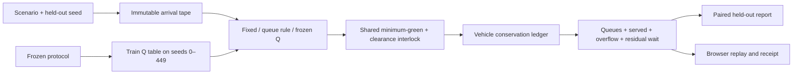

# Architecture and decisions

## Physical-model contract

There are two aggregate incoming directions, no turns or downstream network. Each tick: process switch request/overdue switch, admit arrivals up to capacity, record overflow, discharge only the open phase unless all-red, record end-of-tick queues. Newly admitted vehicles may discharge with zero waiting time. Capacity is checked before service, an explicit discretization choice. A 50-vehicle queue is a bounded model, not a real link-length calibration.

Five green ticks are required before a switch, and 20 green ticks force one. A switch spends two ticks all-red. The phase variable denotes the target direction during clearance; the allRed flag controls discharge and rendering. No dual green is modeled. These are simulator invariants, not traffic-safety certification.

Every arrival remains in arrived = served + overflow + remaining. Mean queue is end-of-tick queue area / ticks. The 95th served wait uses the nearest-rank definition and excludes unserved vehicles; remaining and overflow must be reported beside it. Ticks have no physical seconds calibration.

## Learning and evaluation

State includes queue bins, phase, green age and clearance countdown. Requested actions are filtered by the same interlock for every controller. Reward is negative queue sum minus 30 per overflow minus 2 per switch. Terminal training steps do not bootstrap beyond the finite episode. Tidal demand and reduced service are exogenous changes not completely observed in the state; this is an abstraction with limits, not a perfect real-world Markov model.

A single run was frozen before evaluation. The simple queue rule uses a two-vehicle hysteresis; no claimed max-pressure stability theorem applies. Paired arrival seeds support paired comparisons, but 20 seeds and one trained policy do not establish generalization over road layouts, demand distributions or training initializations. The bootstrap intervals are per-scenario; no multiplicity adjustment is claimed. No holdout-driven retraining occurred.

## Browser execution and boundaries

The browser loads the same frozen numeric Q table and typed scenario definitions; a worker runs all three controllers on the same tape. File hashes verify the public policy bytes. Python/JavaScript full-trace parity tests detect porting errors. A byte hash establishes identity, not independent provenance or security of a compromised same-origin host.

The worker is bounded to 240 ticks and terminated on cancel or eight-second deadline. Playback is separate, paused by default and stopped on tab visibility changes. A focus change does not rerun or alter traffic. Pending form changes do not relabel completed results or exports. Share links contain only allowlisted scenario/controller and a bounded integer seed; no document uploads or personal records are accepted.

The production CSP permits only same-origin scripts, styles, worker and connections, blocks framing/object embedding, and uses no external fonts. SVG queue icons show at most 16 cars per direction; numeric counters show the full queue. Artifact exports contain synthetic records and qualified metrics. No third-party model is called.

## Deployment plan

Only a static website is needed. The authenticated existing asmq333 inventory has no traffic project. A new free Hobby project requires explicit release approval before creation; no existing project's settings or aliases may be changed. Browser verification runs on GitHub runners, not the owner's computer. Production success requires exact commit identity, public artifact hashes, HTTP checks and actual staged/public browser receipts with screenshots reviewed. Main merge is excluded unless separately authorized.

Summary and bootstrap means use an explicit left-to-right addition order. Python 3.12 changed built-in sum for floats; fixing the order preserves the archived Python 3.10 numeric results exactly without loosening equality checks, rounding results or changing the trained policy.
